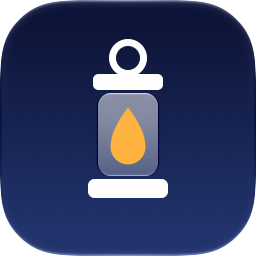

<p align="center">
  
</p>

# Nightwatchman

Keeps your Mac awake from the menu bar, also when the lid is closed.

## Build

```sh
brew install xcodegen
echo 'DEVELOPMENT_TEAM = <your team ID>' > Local.xcconfig
xcodegen generate
open Nightwatchman.xcodeproj
```

To run the tests:

```sh
./test.sh
```

## License

MIT. See [LICENSE](LICENSE).
